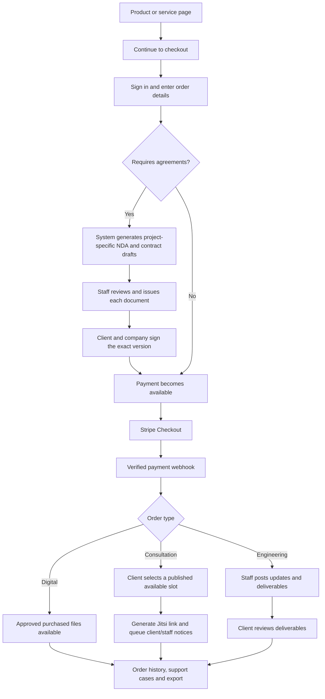

# Current order workflow

## Staff controls and expectations

| Control | Current effect | Prerequisite |
| --- | --- | --- |
| Staff portal | Opens commerce administration | Verified staff account and authenticator verification |
| Products | Edit price, scope, publication and checkout availability | Owner, admin or editor role |
| Issue document | Publishes an immutable version for client signature | Reviewed draft and appropriate staff role |
| Record negotiation | Adds proposal, objection or decision to order history | Access to the order |
| Confirm bank settlement | Records a real bank payment | Live payment mode and owner/admin role; unavailable in sandbox |
| Calendar | Publish availability and manage booked appointments | Appropriate staff role |
| Meeting URL | Generates a random Jitsi link after booking; staff can replace it | Production `MEETING_PROVIDER=jitsi`; host signs in to start the room |
| Files | Upload, review and approve delivery files | Appropriate access; private files remain controlled |
| Export | Downloads the project record | Access to the order |

## Current limitations to resolve

Digital showcase items cannot be purchased until approved bundles exist and checkout is enabled. NDA and contract drafts are automatic, but issuing them still requires staff review. Calls are booked after payment; production generates Jitsi links and queues email with scheduled retries. A live two-person call still needs checking. Google sign-in requires provider activation; see `google-login-activation.md`. Apple is not part of the current requested addition. Phone collection does not yet verify the phone number. Sandbox bank settlement is intentionally rejected; use Stripe test checkout to exercise verified-payment workflows.
